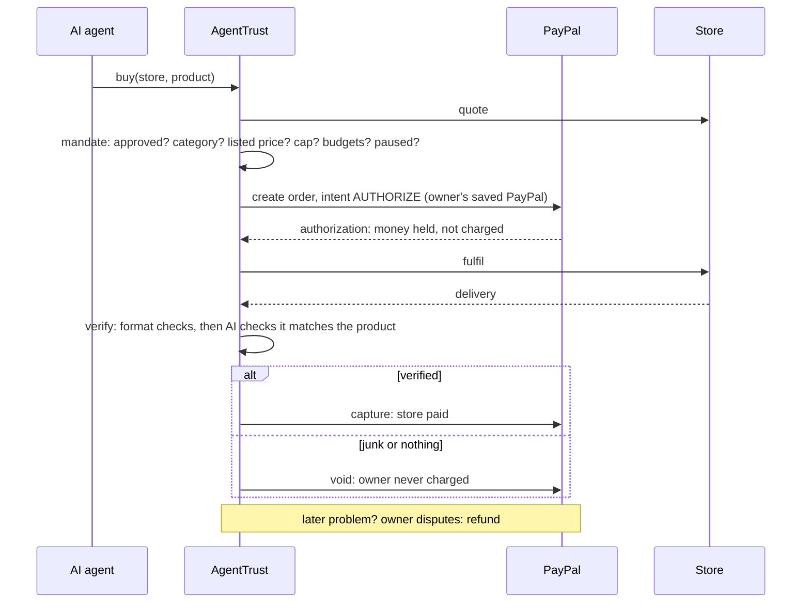

# AgentTrust

**Safe PayPal payments for AI agents.** Your agent shops on its own; AgentTrust
holds every purchase on PayPal and pays the store only after the delivery is
verified, inside the limits you set.

Built for the PayPal AI Hackathon 2026 (Best Use of Agentic Commerce).

## The problem

AI agents are starting to buy things: data, e-books, flights, services. Give an
agent your PayPal and it will pay whatever a store asks:

- a **lookalike store** that copies a known name,
- an **inflated invoice** (lists $2, bills $40),
- a **billing loop** that never stops,
- a store that **takes the money and never delivers**,
- a store that **delivers junk**,
- and anyone who **steals the agent's token**.

## How AgentTrust works

Two halves of agentic commerce:

| Buyer side: the trust layer | Seller side: the store kit |
|---|---|
| The owner approves PayPal **once** (a saved PayPal payment method), so the agent never needs a checkout window | A merchant describes the shop in plain words; **AI builds the catalog**, including what each buyer must receive |
| The owner's **mandate**: approved stores, a daily budget per store, allowed categories, per-purchase cap, daily limit, minimum reputation, Pause | The store gets an **agent-ready storefront**: a manifest plus `catalog`, `quote` and `fulfil` endpoints |
| Every purchase is **authorized** on PayPal, not captured | **Reputation** is earned: verified deliveries vs voided holds vs refunds |

One purchase:



## Demo: six attacks, six stops

| # | Scene (Gemini agent) | Attack | Stopped by |
|---|---|---|---|
| 1 | Market brief | Agent picks a cheaper lookalike store | Approved stores |
| 2 | Cheap flight | Store lists $2.00, invoices $40.00 | Listed price check, before PayPal |
| 3 | Live ticker | Store bills per tick, forever | Store's daily budget |
| 4 | Instant quote | Store takes the order, never delivers | PayPal hold **voided** |
| 5 | Daily digest | Store delivers an error page | AI verification, hold **voided** |
| 6 | Stolen token | Gift cards, unapproved store, inflated invoice, raising limits | Rules, owner-only API, Pause |

Honest stores sell real data (CoinGecko, Hacker News, open-meteo).

## PayPal APIs used

| API | Used for |
|---|---|
| Vault v3 setup tokens and payment tokens | The owner approves once; agents buy without a checkout window |
| Orders v2, `intent: AUTHORIZE` with `vault_id` | Holding the money for each purchase |
| Payments v2 authorizations: capture and void | Paying for verified deliveries; releasing failed ones |
| Payments v2 captures: refund | Disputes after capture |
| `PayPal-Request-Id` idempotency keys | Safe retries |

## Any agent can use it

- **MCP server** (`pnpm mcp`): Claude, Cursor or any MCP client gets
  `search_stores`, `buy`, `budget_status`, `my_purchases` and `dispute`.
  ```bash
  claude mcp add agenttrust -e AGENTTRUST_URL=http://localhost:4500 -e AGENTTRUST_TOKEN=at_... -- pnpm --dir /path/to/AgentTrust mcp
  ```
- **HTTP**: `POST /agent/v1/buy` with `Authorization: Bearer <agent token>`.
- Agent tokens can never use the owner API: an agent cannot change its own rules.

## Run it

Node 22+ and pnpm.

```bash
pnpm install
cp server/.env.example server/.env    # GEMINI_API_KEY; PayPal keys for sandbox mode
cp web/.env.example web/.env.local
pnpm server                           # :4500
pnpm web                              # :5190
```

`PAYPAL_MODE=mock` runs the same flows without PayPal. For the real sandbox:

1. On developer.paypal.com, create a **sandbox REST app** and enable
   **Save payment methods** (Vault) in its settings.
2. Put `PAYPAL_MODE=sandbox`, `PAYPAL_CLIENT_ID` and `PAYPAL_CLIENT_SECRET` in `server/.env`.
3. `pnpm paypal:check` verifies the keys and the vault feature.
4. Start the server, open the dashboard, press **Connect PayPal** and log in
   with a **sandbox personal** account.

Tests: `pnpm test` runs 13 end-to-end checks through the HTTP API (every
protection, hold/capture/void/refund, store kit, owner controls).
Terminal agent: `pnpm agent "Prepare a short market brief on Solana"` or `pnpm agent attack`.

## Repository

| Path | What |
|---|---|
| `server/paypal.ts` | PayPal REST client (sandbox) and a mock with the same interface |
| `server/trust.ts` | The trust engine: rules, authorize, fulfil, verify, capture/void, refund |
| `server/verify.ts` | Delivery checks: format, then AI |
| `server/storekit.ts` | AI catalog builder and store publishing |
| `server/stores/` | Storefront protocol and demo stores |
| `server/agent.ts` | Gemini shopping agent and the stolen-token scene |
| `mcp/server.ts` | MCP server for any agent |
| `web/` | Dashboard, marketplace, store kit (React, Tailwind, AG Grid) |

## Notes

- Sandbox only: no real money moves.
- Delivery verification combines format checks with an AI judgement against
  the product's promised deliverable; the content hash of every delivery is
  recorded with the purchase.
- PayPal authorizations are honored for 3 days, so physical goods with longer
  delivery would capture on a tracking confirmation; this demo sells digital
  goods and services.

MIT licence.
