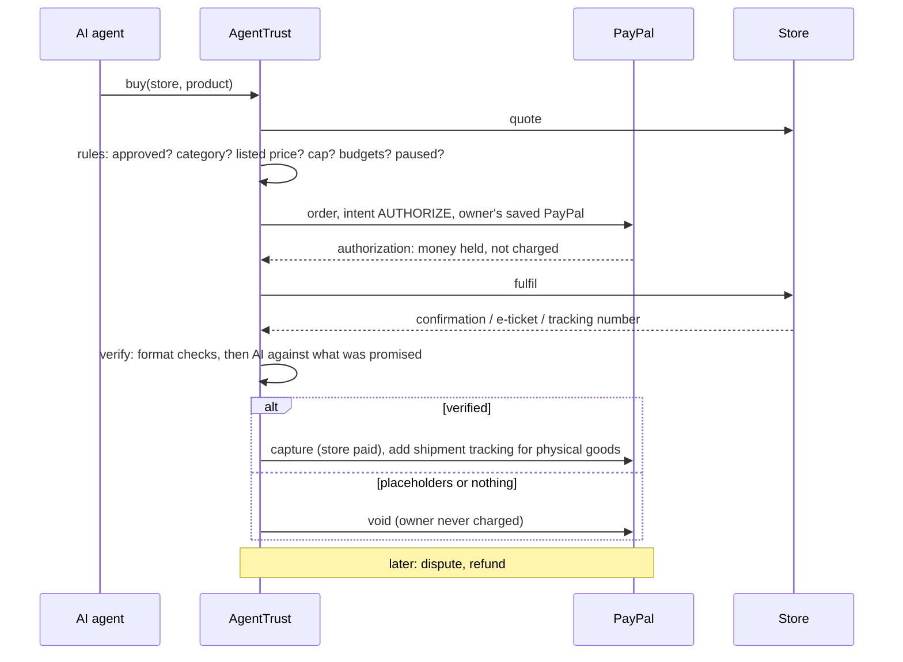

# AgentTrust

**Let your AI agent shop with PayPal. Pay only for what actually arrives.**

AgentTrust sits between AI agents and PayPal. The owner approves PayPal once and
sets the rules. Every purchase the agent makes is **authorized** on PayPal, so
the money is held, not charged. It is **captured** only after the delivery is
verified, **voided** if the store fails, and **refunded** if a problem shows up
later.

Built for the PayPal AI Hackathon 2026: Best Use of Agentic Commerce and Best Use of PayPal + AI.

## The problem

Assistants are starting to buy hotel rooms, subscriptions, flowers and
freelance work for us. Hand one your PayPal and it pays whatever a store asks:

- a **lookalike site** of a known hotel brand,
- an **invoice four times** the listed price,
- a subscription whose **price jumps on renewal**,
- a store that **takes the order and never ships**,
- a freelancer who **delivers placeholders**,
- and anyone who **steals the agent's token** goes straight for gift cards.

## How it works

| Buyer side: the trust layer | Seller side: the store kit |
|---|---|
| The owner approves PayPal **once** (a saved PayPal payment method, Vault v3), so the agent never needs a checkout window | A shop describes what it sells in plain words; **AI builds the catalog**, including what each buyer must receive |
| The owner's **rules**: approved stores, a daily budget per store, allowed categories, per-purchase cap, daily limit, minimum reputation, Pause | The shop gets an **agent-ready storefront** (manifest, catalog, quote, fulfil) and is paid into **its own PayPal account** |
| Every purchase: **authorize → verify delivery → capture or void** | **Reputation** comes from real outcomes: captured, voided, refunded |



## Demo scenes

| # | Scene (Gemini agent) | What the merchant does | Stopped by |
|---|---|---|---|
| 1 | Hotel in Paris | Lookalike site "StayWel"; a hotel that invoices $480 for a $120 room | Approved stores; listed price, before PayPal |
| 2 | Design tool | $9.99 first month, $49.99 on renewal | Listed price on every renewal |
| 3 | Flowers for mum | Takes the order, never ships | PayPal hold **voided** |
| 4 | Logo design | Delivers "lorem ipsum, coming soon" | AI verification, hold **voided** |
| 5 | Weekend plan | Honest stores: e-book, ticket, bouquet | **Captured**, with tracking on the PayPal order |
| 6 | Stolen token | Gift cards, lookalike, 4x invoice, then PayPal's money tools directly | Rules, toolkit policy, owner-only API, Pause |

## PayPal building blocks

| PayPal API | Used for |
|---|---|
| Vault v3: setup tokens and payment tokens | Approve once; agents buy without a checkout window |
| Orders v2, `intent: AUTHORIZE` with `vault_id` | Hold the money for each purchase; `payee` pays the store's own PayPal |
| Payments v2: capture, void | Pay for verified deliveries; release failed ones |
| Payments v2: refund | Disputes after capture |
| Orders v2: shipment tracking | Tracking number on physical orders |
| Webhooks, with signature verification | PayPal's confirmation of each step in the purchase timeline |
| **PayPal Agent Toolkit** tool names | A policy firewall: read tools pass, money tools are routed through the rules, merchant and owner tools are denied |
| `PayPal-Request-Id` | Idempotent retries |

## Any agent can use it

- **MCP server** (`pnpm mcp`): `search_stores`, `buy`, `budget_status`,
  `my_purchases`, `dispute` and `paypal` (Agent Toolkit tools under the policy).
  ```bash
  claude mcp add agenttrust -e AGENTTRUST_URL=http://localhost:4500 -e AGENTTRUST_TOKEN=at_... -- pnpm --dir /path/to/AgentTrust mcp
  ```
- **HTTP**: `POST /agent/v1/buy` with `Authorization: Bearer <agent token>`.
- Agent tokens are refused on the owner API: an agent can never change its own rules.

## Run it

Node 22+ and pnpm.

```bash
pnpm install
cp server/.env.example server/.env    # GEMINI_API_KEY, PayPal keys for sandbox mode
cp web/.env.example web/.env.local
pnpm server                           # :4500
pnpm web                              # :5190
```

`PAYPAL_MODE=mock` runs the same flows without PayPal. For the sandbox:

1. On developer.paypal.com, create a **sandbox REST app** and enable **Save payment methods** (Vault).
2. Set `PAYPAL_MODE=sandbox`, `PAYPAL_CLIENT_ID`, `PAYPAL_CLIENT_SECRET` in `server/.env`.
3. `pnpm paypal:check` verifies the keys and Vault.
4. Open the dashboard, press **Connect PayPal**, log in with a **sandbox personal** account.
5. Optional: add a webhook in the app pointing to `/webhooks/paypal` and set `PAYPAL_WEBHOOK_ID`.

Tests: `pnpm test` runs 14 end-to-end checks through the HTTP API.
Terminal agent: `pnpm agent "Book me a hotel room in Paris for tomorrow night"` or `pnpm agent attack`.

## Repository

| Path | What |
|---|---|
| `server/paypal.ts` | PayPal REST client (sandbox) and a mock with the same interface |
| `server/trust.ts` | Rules, authorize, fulfil, verify, capture/void, tracking, refund |
| `server/paypal-tools.ts` | Agent Toolkit tool policy |
| `server/verify.ts` | Delivery checks: format, then AI |
| `server/storekit.ts` | AI catalog builder, store publishing |
| `server/stores/` | Storefront protocol and demo stores |
| `server/agent.ts` | Gemini shopping agent and the stolen-token scene |
| `mcp/server.ts` | MCP server for any agent |
| `web/` | Dashboard, marketplace, store kit (React, Tailwind, AG Grid) |

## Notes

- Sandbox only: no real money moves. Demo store deliveries (bookings, tickets, tracking numbers) are generated.
- PayPal honors an authorization for 3 days, which covers digital goods, bookings and short shipping; longer deliveries would reauthorize.
- Delivery verification combines format checks with an AI judgement against the product's promised deliverable; each delivery's content hash is kept with the purchase.

MIT licence.
