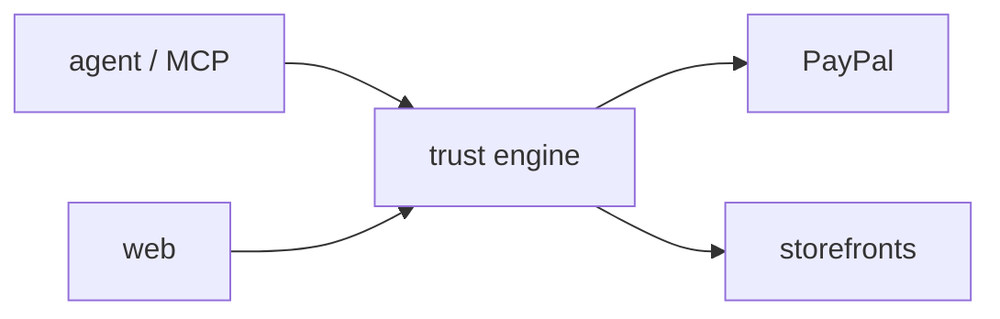

---
tags:
  - memory
  - architecture
  - agenttrust
last_updated: 2026-11-09
---

# Architecture

Agent (Gemini, MCP client or HTTP with agent token) → `POST /agent/v1/buy` → [[trust-engine]]: store quote → mandate rules → PayPal order intent AUTHORIZE with the owner's vaulted payment token → store `fulfil` → sha256 + verify (format checks, then AI) → capture or void. Owner can refund captured purchases.

- Entry points: `pnpm server` (:4500), `pnpm web` (:5190), `pnpm mcp`, `pnpm agent`
- State: JSON file `data/state.json` (gitignored); demo seed on every boot
- External: PayPal sandbox, Gemini, CoinGecko, HN Algolia, open-meteo

Back to [[index]]
